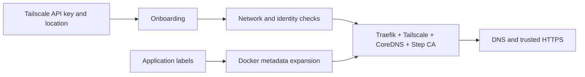

# Shared ingress

One container runs Traefik, Tailscale, CoreDNS and Step CA under Process Compose. Onboarding asks for your Tailscale API key and where this host belongs, checks networks, allocates an ingress subnet, sets up DNS and certificates, and installs Docker label discovery.

## Set up a host

Run on Linux or inside the WSL2 distro that hosts Docker. Install Docker Engine with Compose, Bun and sudo, then:

```sh
git clone https://github.com/teyfix/traefik
cd traefik
bun install --frozen-lockfile
bun scripts/onboarding.ts
```

Enter your Tailscale API key and private DNS suffix when prompted. The key needs permission to manage the relevant devices, keys, DNS and policy. Existing unrelated Tailnet settings are preserved. For automation, use `TS_API_KEY`, `TRAEFIK_INGRESS_DOMAIN` and optionally `TRAEFIK_HOSTNAME`. The setup API key is transient and is not passed to service containers.

Onboarding retrieves its helper automatically, creates a persistent router identity and selects the `teyfix` Docker context. No image selection, private repository or local compilation is required. `--domain dev.example.test`, `--hostname my-host`, `--install-dir /path` and `--dry-run` are optional. A dry run may download artifacts but leaves host services and Tailnet settings unchanged.

Existing ingress state is preserved: fresh onboarding refuses to overwrite a different installation. An existing split-container installation requires a state-preserving migration, rather than rerunning fresh setup. See [legacy operations](README.legacy.md) for that model.



## Operate the installation

```sh
docker compose ps
docker compose logs --tail 100 traefik
docker compose exec traefik ingressctl runtime health
docker compose exec traefik ingressctl runtime recover
```

The dashboard is `https://traefik.<your-domain>/dashboard/`. Its router matches only the hostname and uses Traefik's native internal API service. Application containers join `traefik_proxy`.

The checked-in `docker-compose.yaml` is the single-container default. Onboarding writes private configuration and network wiring, then selects the generated deployment through `.env`. Configuration lives in `traefik.yaml`; CA, router and ACME state live under `.state/`; caches live under `.cache/`. Keep these files and credentials out of Git. Ordinary stops preserve identity and certificates.

## Publish an application route

```sh
docker run --rm --network traefik_proxy \
  --label teyfix/traefik.auto=true traefik/whoami
```

Use the selected `teyfix` Docker context for expansion. An explicit Docker socket or context can bypass it. The configured HTTP default uses a single exposed TCP port; ambiguous ports require an explicit selection:

```yaml
labels:
  teyfix/traefik.auto: "true"
  teyfix/traefik.http: "8080"
```

Discovery fills project, service and worktree identity from available labels, Compose metadata, allowed environment variables, Git/worktree and mount evidence, then image/container metadata. Explicit values override inferred values. Application hostnames follow `{service}.{worktree}.{project}.{domain}`. Traefik itself resolves to `traefik.{domain}`.

## Client trust

Clients need access through the Tailnet and must trust this installation's root CA. Export only the public certificate with `task certs`, verify its fingerprint through a trusted channel, then register it in the client trust store. Linux/Windows trust and WSL2 support are implemented by `ingressctl trust`; run `.cache/traefik-bootstrap/bin/ingressctl trust install --help` on the client for flags. Never share CA private keys or another host's Tailscale identity.

## Development

The implementation lives in the Containers catalog; the public release includes its buildable source and dependency notices. Operators use this repository's default onboarding. Contributors with a source checkout can use `bun scripts/onboarding.ts --bundle-source /path/to/containers` to build a local override. This is optional and requires Buildx.

Run `task check:agent-rules` for repository checks. Legacy address checks explicitly select `docker-compose.legacy.yaml`.
