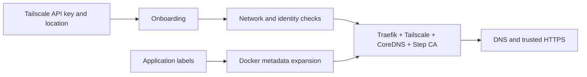
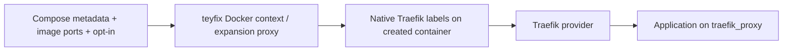

# Shared ingress

One container runs Traefik, Tailscale, CoreDNS and Step CA under Process Compose. Onboarding asks for your Tailscale API key and where this host belongs, checks networks, allocates an ingress subnet, sets up DNS and certificates, and installs Docker label discovery.

## Set up a host

Run on Linux or inside the WSL2 distro that hosts Docker. Install Docker Engine with Compose, Bun and sudo, then:

```sh
git clone https://github.com/teyfix/traefik
cd traefik
bun install --frozen-lockfile
bun scripts/onboarding.ts
```

Enter your Tailscale API key and private DNS suffix when prompted. The key needs permission to manage the relevant devices, keys, DNS and policy. Existing unrelated Tailnet settings are preserved. For automation, use `TS_API_KEY`, `TRAEFIK_INGRESS_DOMAIN` and optionally `TRAEFIK_HOSTNAME`. The setup API key is transient and is not passed to service containers.

Onboarding retrieves its helper automatically, creates a persistent router identity and selects the `teyfix` Docker context. No image selection, private repository or local compilation is required. `--domain dev.example.test`, `--hostname my-host`, `--install-dir /path` and `--dry-run` are optional. A dry run may download artifacts but leaves host services and Tailnet settings unchanged.

Existing ingress state is preserved: fresh onboarding refuses to overwrite a different installation. An existing split-container installation requires a state-preserving migration, rather than rerunning fresh setup. See [legacy operations](README.legacy.md) for that model.



## Operate the installation

```sh
docker compose ps
docker compose logs --tail 100 traefik
docker compose exec traefik ingressctl runtime health
docker compose exec traefik ingressctl runtime recover
```

The dashboard is `https://traefik.<your-domain>/dashboard/`. Its router matches only the hostname and uses Traefik's native internal API service. Application containers join `traefik_proxy`.

The checked-in `docker-compose.yaml` is the single-container default. Onboarding writes private configuration and network wiring, then selects the generated deployment through `.env`. Configuration lives in `traefik.yaml`; CA, router and ACME state live under `.state/`; caches live under `.cache/`. Keep these files and credentials out of Git. Ordinary stops preserve identity and certificates.

## Publish an application route

For an existing application, keep its image, private networks and other settings; add the external `traefik_proxy` network and opt into discovery. For a small standalone example, put this in `svc/whoami/compose.yaml`:

```yaml
services:
  whoami:
    image: traefik/whoami:v1.11.0
    networks: [traefik_proxy]
    labels:
      teyfix/traefik.auto: "true"

networks:
  traefik_proxy:
    external: true
```

Include it from the application root's `compose.yaml` (merge into an existing `include` list):

```yaml
include:
  - path: svc/whoami/compose.yaml
```

Create the container through the onboarding-selected `teyfix` Docker context:

```sh
docker --context teyfix compose up -d whoami
```

With the host's HTTP/domain defaults configured and one effective exposed TCP port, `auto=true` is the only required label. Port metadata comes from the image and container creation request, including Compose `expose`; `expose` does not publish a host port. The service must actually join `traefik_proxy`. The provider already selects that network, so no per-service `traefik.docker.network` label is needed. Do not publish backend host ports or attach applications to the ingress router's network.

Expansion happens before container creation. Recreate an existing service through the proxy after changing labels; editing Compose alone does not update its labels. An explicit socket, `DOCKER_HOST` or another Docker context can bypass expansion. A normal application-only adoption does not require restarting the ingress bundle.



### Names and explicit selections

Discovery resolves each field separately: explicit Teyfix labels/configuration, image Teyfix labels, then Compose metadata, allowed identity environment variables, Git/worktree and bind-mount evidence, project networks, container/image names and configured defaults. Native Traefik policy remains authoritative. Linked Git worktrees use the canonical repository as the project and their checkout directory as the worktree name; this can differ from Compose's runtime project namespace. Without Compose or bind workspace evidence, the caller's current directory is unavailable and names fall back to image/container metadata.

| Checkout | Hostname | Example for service `whoami`, project `example`, domain `tail.gg` |
| --- | --- | --- |
| Main | `{service}.{project}.{domain}` | `whoami.example.tail.gg` |
| Named worktree `feature` | `{service}.{worktree}.{project}.{domain}` | `whoami.feature.example.tail.gg` |

The same naming applies to HTTP and TLS/SNI TCP routes. The main checkout retains `main` internally; only the hostname omits it. Traefik's own hostname is `traefik.{domain}` and uses its native `api@internal` service.

Zero or multiple exposed TCP ports require an explicit port. Select HTTP with:

```yaml
labels:
  teyfix/traefik.http: "8080"
```

`teyfix/traefik.http.port: "8080"` is equivalent. Either selection opts in without `auto=true`. For TCP, select the protocol explicitly and use the host's existing listener/TLS policy, for example:

```yaml
labels:
  teyfix/traefik.tcp: "5432"
  teyfix/traefik.tcp.entrypoint: shared
  teyfix/traefik.tcp.tls: "true"
  traefik.tcp.routers.database.tls.certresolver: stepca
```

This targets the existing `shared` entrypoint (port `4040` in the default stack). The native certificate-resolver label retains certificate policy on the generated router; use distinct native router names for distinct services. Ports do not identify application protocols; a database's exposed `5432` alone does not select TCP. Clients must support the configured TLS/SNI route. `teyfix/traefik.auto: "false"` disables expansion even when route-selection labels are present.

### Migrating native labels

For a simple HTTP service using the default generated hostname, replace its repetitive native enable/router/TLS/service-port labels with `auto=true` and keep the network attachment. Retain an explicit port only when metadata cannot select it unambiguously. Project, service, worktree, domain and host labels can be omitted when discovery already resolves the intended values.

Keep native labels for multiple hosts or routers, middleware chains, authentication, caching, Sablier and other application policy. Existing native labels remain supported and win over generated values; discovery does not require a per-project routing DSL or separate router YAML. Private services need no opt-in. Do not opt them in merely because a port is exposed.

Use an explicit host only to preserve an intentional name that differs from the convention:

```yaml
labels:
  teyfix/traefik.auto: "true"
  teyfix/traefik.http.host: legacy.example.test
```

Before replacing a native route, check its current hostnames, backend port, networks and policy. Keep any setting that discovery does not reproduce, then verify the expected HTTPS/TCP path from an authorized client after recreation.

## Client trust

Clients need access through the Tailnet and must trust this installation's root CA. Export only the public certificate with `task certs`, verify its fingerprint through an independent authenticated channel, then register it in the client trust store. Linux/Windows trust and WSL2 support are implemented by `ingressctl trust`; run `.cache/traefik-bootstrap/bin/ingressctl trust install --help` on the client for flags. Obtain client helpers from the public release over already-trusted HTTPS. An optional private install page cannot establish first trust by itself. Server onboarding does not install client Tailscale or host/browser CA trust. Never share CA private keys or another host's Tailscale identity.

## Development

The implementation lives in the Containers catalog; the public release includes its buildable source and dependency notices. Operators use this repository's default onboarding. Contributors with a source checkout can use `bun scripts/onboarding.ts --bundle-source /path/to/containers` to build a local override. This is optional and requires Buildx.

Run `task check:agent-rules` for repository checks. Legacy address checks explicitly select `docker-compose.legacy.yaml`.
